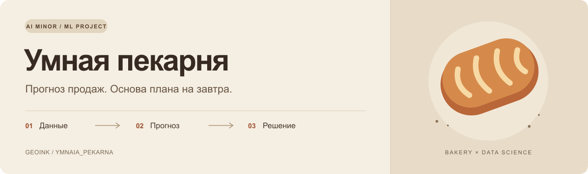
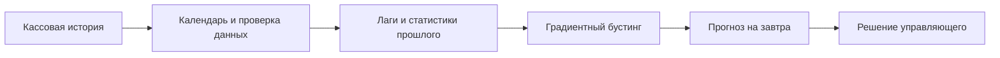
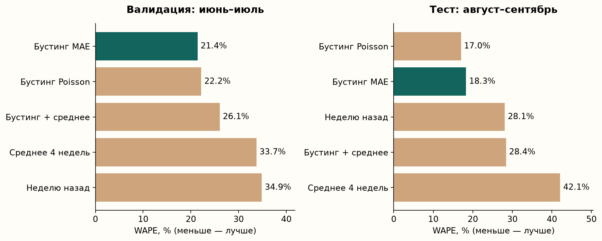
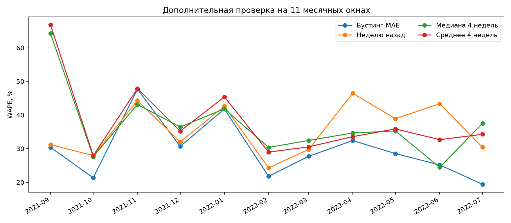

<p align="center">
  
</p>

<p align="center">
  <a href="https://github.com/geoink/Ymnaia_Pekarna/actions/workflows/ci.yml"></a>
  
  
  <a href="LICENSE"></a>
</p>

<p align="center">
  <a href="docs/coursework.md">Курсовая</a> ·
  <a href="notebooks/01_bakery_forecasting.ipynb">Ноутбук</a> ·
  <a href="reports/results.md">Результаты</a> ·
  <a href="docs/presentation.pptx">Презентация</a> ·
  <a href="docs/ml_team/backlog.md">ML-команда</a>
</p>

# Умная пекарня

**Сколько выпечки подготовить к завтрашнему дню?** Проект прогнозирует продажи восьми товаров по истории кассы и календарю, чтобы управляющий мог составить обоснованный план выпуска.

Курсовая по ИИ-майнору: реальный открытый набор данных, временная валидация, воспроизводимые эксперименты и план внедрения в небольшую пекарню. Статус — исследовательский прототип; бизнес-эффект предстоит проверить на пилоте.

| 18,28% | −34,88% | 10 из 11 |
|:---:|:---:|:---:|
| WAPE основной модели на исходном тесте | Относительное снижение WAPE против «как неделю назад» на том же тесте | Месяцев с меньшей ошибкой против этого правила в дополнительной проверке |

Тест: август–сентябрь 2022, 472 наблюдения «товар–день». Дополнительная проверка: сентябрь 2021 — июль 2022; выполнена ретроспективно. **Снижение ошибки прогноза не означает доказанное снижение списаний или рост прибыли.**

## Задача и решение

Излишек выпечки приводит к списаниям, нехватка — к потерянным продажам. Каждый вечер управляющий выбирает объём выпуска на следующий рабочий день. Гипотеза проекта: история продаж и календарь помогают прогнозировать продажи точнее простых правил.



Выход текущего прототипа — прогноз нетто-продаж в штуках. Чтобы превратить его в план выпуска, нужны себестоимость, остатки и ограничения печи. Эта часть описана в заданиях команде. ML уже применяется в пекарнях; [обзор исследований](docs/research_review.md) объясняет контекст и границы нашей задачи.

## Навигация по проекту

| Что посмотреть | Где находится |
|---|---|
| Бизнес-задача, гипотеза и полный текст | [Курсовая](docs/coursework.md) |
| Код исследования с сохранёнными результатами | [Jupyter Notebook](notebooks/01_bakery_forecasting.ipynb) |
| Сравнение моделей и экономические сценарии | [Основные результаты](reports/results.md) |
| Литература, 11 окон, вклад признаков и неопределённость | [Обзор](docs/research_review.md) · [Расширенный эксперимент](reports/research/results.md) |
| Данные, предположения и границы модели | [Data card](docs/data_card.md) · [Model card](docs/model_card.md) |
| Материалы для защиты | [Слайды PPTX](docs/presentation.pptx) · [Текст выступления](docs/presentation.md) · [Вопросы](docs/defense_questions.md) |
| Постановка и внедрение | [Бриф](docs/ml_team/brief.md) · [18 задач](docs/ml_team/backlog.md) · [Поставки](docs/ml_team/delivery_plan.md) |

## Быстрый запуск

Нужен Python 3.11 или новее. Проверенный полный эксперимент выполнен на Python 3.14.4. Команды выполняются из корня репозитория.

```bash
git clone https://github.com/geoink/Ymnaia_Pekarna.git
cd Ymnaia_Pekarna
python3 -m venv .venv
source .venv/bin/activate
python -m pip install -e '.[dev]'
bakery download
bakery run
bakery forecast
```

В Windows создание окружения: `py -m venv .venv`, активация в PowerShell: `.venv\Scripts\Activate.ps1`. Остальные команды те же.

`bakery download` скачивает оригинальный CSV с Kaggle и проверяет SHA-256. Если Kaggle запрашивает вход или недоступен, скачайте `Bakery sales.csv` со [страницы автора](https://www.kaggle.com/datasets/matthieugimbert/french-bakery-daily-sales) и положите в `data/raw/`.

Для файла в другой папке:

```bash
bakery run --data '/path/to/Bakery sales.csv'
bakery forecast --data '/path/to/Bakery sales.csv'
```

Команда `run` создаёт таблицы, графики, текст результатов и `models/forecast.joblib`. Последний артефакт переобучен на всей доступной истории **после** независимой оценки. `forecast` выдаёт прогноз на день после последней даты в данных: у исходного набора это **1 октября 2022 года**, а не текущая дата. Пример в `docs/forecast_example.csv` не имеет известного фактического результата.

Для точного воспроизведения сохранённого запуска на Python 3.14 используйте `requirements-lock-py314.txt` перед `pip install --no-deps -e .`. На другой версии Python устанавливайте зависимости из `pyproject.toml`; небольшие численные отличия возможны.

### Ноутбук

```bash
python -m pip install -e '.[notebook]'
jupyter lab notebooks/01_bakery_forecasting.ipynb
```

Ноутбук вызывает тот же код, что и CLI, и повторяет эксперимент. На GitHub его можно читать с сохранёнными результатами без запуска. Сырые данные и обученная модель не входят в публикационный архив: они создаются локально.

### Проверки

```bash
python -m pytest -q
ruff check .
```

Тестовые данные синтетические и используются только для проверки программы. Все метрики курсовой вычислены на оригинальном датасете.

## Данные и подготовка

[French Bakery Daily Sales](https://www.kaggle.com/datasets/matthieugimbert/french-bakery-daily-sales), автор публикации Matthieu Gimbert. Оригинальный CSV содержит 234 005 строк за 02.01.2021–30.09.2022, 149 названий товаров и услуг, 600 дат с записями. Характеристики проверены на скачанном файле; происхождение от реальной пекарни указано автором набора.

Для исследования зафиксированы восемь регулярно продающихся видов хлеба и выпечки. Нарезка `COUPE`, сборные наборы и категории `DIVERS` не включены. Возвраты и корректировки суммируются с положительными продажами. Даты без записей остаются неизвестными. Подробности и контрольная сумма: [карточка данных](docs/data_card.md).

У исходного набора указана лицензия **Data files © Original Authors**. Лицензия кода не распространяется на исходные данные. Они исключены из Git и скачиваются пользователем отдельно. См. [DATA_LICENSE.md](DATA_LICENSE.md).

## Результаты и протокол



| Период | Назначение |
|---|---|
| 02.01.2021–31.05.2022 | История для первого обучения; первые 35 календарных дней — прогрев признаков |
| Июнь 2022 | Первая валидация |
| Июль 2022 | Вторая валидация; обучение расширено до конца июня |
| Август–сентябрь 2022 | Финальный тест; обучение до конца июля |

Каждый прогноз использует только предыдущие даты. В тесте история ежедневно пополняется фактическими продажами, веса модели не обновляются. Два дня сентября без записей не оцениваются. Итого 472 тестовых наблюдения: 59 дней × 8 товаров.

Сравниваются два базовых метода, два варианта `HistGradientBoostingRegressor` и смесь бустинга с базовым прогнозом. Число деревьев и другие параметры заданы заранее. Случайного разделения по строкам и случайной внутренней валидации нет.

| Метод | WAPE, валидация | WAPE, тест | MAE, тест, шт. |
|---|---:|---:|---:|
| Как неделю назад | 34,85% | 28,07% | 18,78 |
| Среднее 4 одинаковых дней недели | 33,73% | 42,08% | 28,15 |
| **Бустинг MAE, выбранная модель** | **21,40%** | **18,28%** | **12,23** |
| Бустинг Poisson | 22,17% | 17,00% | 11,37 |
| Бустинг MAE + среднее, 50/50 | 26,05% | 28,40% | 19,00 |

Poisson лучше на тесте, но выбор основной модели сделан по валидации. Все варианты показаны, чтобы результат можно было оценить без выборочного представления лучших цифр. Среднее четырёх недель особенно отстаёт при снижении продаж в сентябре; см. разбор по месяцам.

**WAPE не является процентом точности.** Это сумма абсолютных ошибок, делённая на суммарные продажи. MAE измеряется в штуках на пару «товар–день».

## Дополнительное исследование

На 11 месячных окнах (сентябрь 2021 — июль 2022) HGB MAE получил объединённый WAPE **28,08%** против **35,18%** у lag7 и выиграл в 10 из 11 месяцев. Добавлены проверки без групп признаков, macro MASE/RMSSE и чувствительность bootstrap к длине блока.



Это ретроспективное расширение после просмотра исходного теста. Оно не меняет выбранную основную модель и не заменяет свежую закрытую оценку. [Обзор источников и выводы](docs/research_review.md), [все числовые результаты](reports/research/results.md).

```bash
bakery research
```

## Экономика и границы выводов

Оценивается стоимость излишка и недополученная маржа при нехватке. Себестоимость задаётся как 30%, 50% или 70% цены. Коэффициент выпуска выбирается на валидации отдельно для каждого метода. Все сценарии: [результаты](reports/results.md).

В данных нет реальных списаний, выпуска и времени отсутствия товара. Продажи могут быть ниже спроса из-за нехватки запасов. Поэтому сценарные потери нельзя выдавать за измеренную экономию. Для внедрения нужны данные конкретной пекарни и пилот.

## Переход к внедрению

- [x] R0: исследование, воспроизводимый код, отчёты и материалы защиты.
- [ ] R1: данные реальной пекарни, себестоимость, выпуск, остатки и списания.
- [ ] R2: новая закрытая оценка, квантили и выполнимый план производства.
- [ ] R3: ежедневный расчёт, мониторинг и наблюдение без изменения выпуска.
- [ ] R4: контролируемый пилот и проверка фактической пользы.

[18 постановок для ML-команды](docs/ml_team/backlog.md) содержат роли, зависимости, оценки и критерии приёмки. Общая предварительная оценка — 50 человеко-дней активной работы; ожидание данных и длительность пилота считаются отдельно. [План поставки](docs/ml_team/delivery_plan.md).

## Структура

```text
src/bakery_forecast/   загрузка, признаки, обучение, прогноз, исследования
notebooks/            выполненный ноутбук для чтения и воспроизведения
reports/              метрики, сценарии, графики и результаты исследований
docs/                 курсовая, презентация, карточки данных и модели
docs/ml_team/         постановка, бэклог и план поставки
scripts/              публикация и импорт задач в GitHub
tests/                проверки данных, признаков, метрик и команд
.github/              CI и шаблоны Issues / PR
```

## Работа над проектом

[Инструкция участнику](CONTRIBUTING.md) · [Публикация в этот репозиторий](docs/github_publish.md) · [GitHub Issues](https://github.com/geoink/Ymnaia_Pekarna/issues)

Проект: [geoink](https://github.com/geoink). Код — [MIT](LICENSE); условия исходных данных описаны [отдельно](DATA_LICENSE.md). Сырые данные и обученные модели создаются локально и не входят в публикационную поставку.
