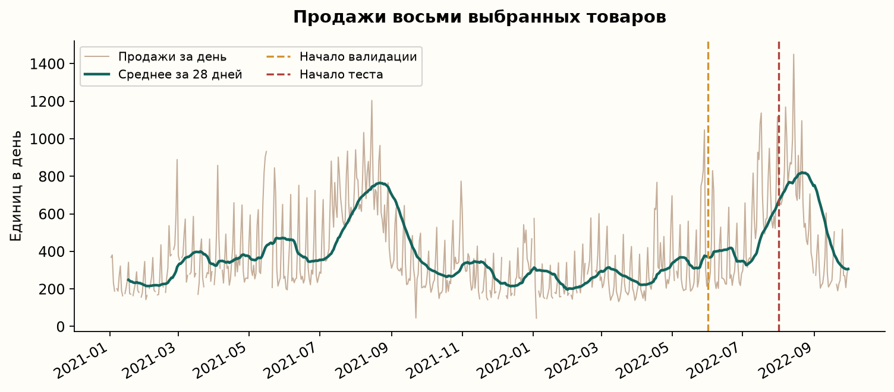
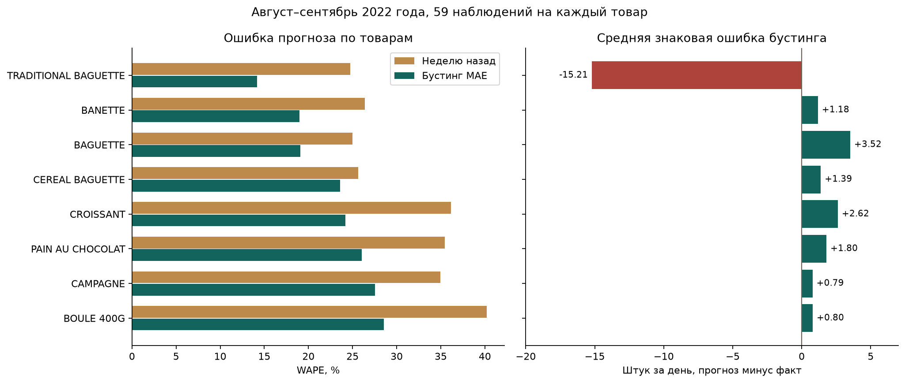

# Прогнозирование продаж для планирования выпечки в небольшой пекарне

Курсовая работа по искусственному интеллекту

## Аннотация

В работе рассматривается задача прогноза продаж хлеба и выпечки на следующий день. Для эксперимента использован открытый набор French Bakery Daily Sales с 234 005 кассовыми записями. По истории восьми товаров построены простые прогнозы и модели градиентного бустинга. Выбранная на валидации модель получила WAPE 18,28% на итоговом тесте. У прогноза по продажам неделю назад эта ошибка составила 28,07%. Отдельно рассмотрены ошибки по товарам, результаты по месяцам и связь прогноза с затратами пекарни.

## 1. Введение

Пекарне нужно ежедневно решать, сколько продукции приготовить. Хлеб и выпечка быстро теряют свежесть, поэтому избыток может привести к списаниям. При недостаточном выпуске часть покупателей уйдёт без покупки. Объём продаж при этом меняется в зависимости от дня недели и недавней динамики спроса.

Для курсовой выбрана небольшая пекарня, потому что у этой задачи понятный результат. По каждому товару можно сравнить прогноз и фактические продажи, а затем оценить, как ошибка влияет на решение о выпуске.

**Цель работы** — построить и проверить модель прогноза ежедневных продаж, которую можно использовать при планировании выпечки.

**Объект исследования** — ежедневные продажи хлебобулочных изделий одной пекарни. **Предмет исследования** — применение календарных признаков и истории продаж для прогноза на следующий день.

Для достижения цели решаются следующие задачи.

1. Описать решение, которое принимает управляющий пекарни.
2. Изучить данные и определить правила обработки пропусков и корректировок.
3. Подготовить целевую переменную и признаки модели.
4. Сравнить несколько способов прогноза на последовательных временных периодах.
5. Разобрать результаты по товарам и месяцам.
6. Связать ошибку прогноза с затратами и предложить план дальнейшего применения.

Машинное обучение уже используется в хлебопечении. Hübner и соавторы исследуют прогнозирование и пищевые отходы на примере пекарни. Fries и Ludwig рассматривают трудности внедрения прогноза в небольшой пекарне. Для этой курсовой основной интерес представляет доступный метод, который можно повторить на открытых данных. [Hübner et al.](https://link.springer.com/article/10.1111/jiec.13528) · [Fries & Ludwig](https://link.springer.com/article/10.1007/s10606-022-09458-z).

## 2. Бизнес-задача и гипотеза

Предполагается, что после закрытия управляющему известны продажи прошедшего дня. Он получает прогноз по каждому товару и составляет план выпечки на следующий рабочий день. В работе рассматриваются одна пекарня и восемь видов продукции.

Исследовательская гипотеза состоит в том, что модель с календарём и историей продаж даст меньшую ошибку, чем два простых правила — повторить продажи неделю назад или взять среднее четырёх предыдущих одинаковых дней недели.

Для проверки гипотезы используется ошибка WAPE на периоде, отложенном для итогового теста. Дополнительно рассчитывается MAE, которая показывает размер ошибки в штуках.

Бизнес-гипотеза состоит в том, что более точный прогноз поможет выбрать объём выпуска с меньшими потерями от излишка и нехватки. Для её проверки нужны фактический выпуск, остатки, себестоимость и списания. В курсовой эта связь исследуется через расчёт затрат при заданных допущениях. Проверка в действующей пекарне предложена как следующий этап.

## 3. Данные и их подготовка

### 3.1. Источник и структура

Использован набор French Bakery Daily Sales, опубликованный Matthieu Gimbert на Kaggle. Автор описывает его как данные продаж французской пекарни. В исходном CSV содержатся 234 005 строк за период с 2 января 2021 года по 30 сентября 2022 года. Записи есть за 600 дат. [Страница набора](https://www.kaggle.com/datasets/matthieugimbert/french-bakery-daily-sales).

| Поле | Содержание | Применение в работе |
|---|---|---|
| date | Дата продажи | Построение ежедневного ряда и календарных признаков |
| time | Время продажи | Описание исходных данных |
| ticket_number | Номер чека | Проверка структуры кассовых записей |
| article | Название товара или услуги | Выбор ассортимента и группировка |
| Quantity | Количество | Расчёт ежедневных продаж |
| unit_price | Цена единицы | Условная оценка стоимости ошибки |

Дополнительный столбец с индексом выгрузки исключён. В наборе встречается 149 названий, включая услуги и составные предложения. Для эксперимента выбраны TRADITIONAL BAGUETTE, CROISSANT, PAIN AU CHOCOLAT, BANETTE, BAGUETTE, CEREAL BAGUETTE, BOULE 400G и CAMPAGNE. У них есть достаточно регулярная история для расчёта признаков.

### 3.2. Принятые решения при очистке

| Особенность данных | Решение | Обоснование |
|---|---|---|
| За 37 календарных дат нет записей | Сохранить неизвестное значение | Причиной могли быть закрытие или неполная выгрузка |
| 1 295 строк с отрицательным количеством | Учесть со знаком при суммировании | Строки могут отражать возвраты и исправления |
| 1 210 совпадающих по содержанию строк | Сохранить | У позиции чека отсутствует уникальный идентификатор |
| 32 строки с нулевой ценой | Учесть количество, исключить цену из расчёта типичной цены | Продажа и оценка цены решают разные задачи |
| Товар отсутствует в день, когда есть другие продажи | Принять продажи товара за ноль | Рабочее допущение для 16 пар «товар–день» |

Количество суммируется по дате и товару. Отрицательный дневной итог ограничивается нулём. Для выбранных восьми товаров таких итогов не оказалось. Получено 4 800 известных значений «товар–день» и 296 неизвестных. Первые 35 календарных дней нужны для накопления истории признаков. Подробные результаты аудита сохранены отдельно. [Аудит данных](../reports/data_audit.json) · [Карточка данных](data_card.md).



## 4. Целевая переменная и признаки

Целевая переменная — количество проданного товара за день с учётом корректировок. Для товара i и дня t она определяется формулой

$$
y_{i,t}=\max\left(0,\sum_{j\in\text{записи}(i,t)}q_j\right).
$$

Здесь q — количество в отдельной кассовой строке. Модель оценивает наблюдаемые нетто-продажи. Если товар закончился раньше закрытия, часть спроса могла остаться за пределами кассовых записей.

| Группа признаков | Примеры | Почему могут помочь |
|---|---|---|
| Товар | Категория article | Объёмы продаж разных изделий отличаются |
| Календарь | День недели, месяц, выходной, годовые синус и косинус, календарный тренд | Покупательские привычки и уровень продаж меняются со временем |
| Лаги | Продажи 1, 7, 14 и 28 дней назад | Показывают недавние значения и недельные повторения |
| Средние | Среднее за 7 и 28 дней, среднее и медиана четырёх одинаковых дней недели | Сглаживают отдельные случайные колебания |
| Разброс и полнота | Стандартное отклонение и число известных дней за 28 дней | Показывают изменчивость и доступность истории |

Лаг означает значение в прошлом. Например, для прогноза на понедельник лаг 7 содержит продажи предыдущего понедельника. Все средние рассчитываются по датам до прогнозируемого дня. В признаках доступны только сведения, которые управляющий мог знать вечером перед прогнозом.

Отдельная проверка программы заменяет текущие и будущие продажи большими числами и сравнивает признаки до выбранной даты. Это позволяет проверить зависимость признаков от времени. [Расчёт признаков](../src/bakery_forecast/features.py) · [Проверки](../tests/test_pipeline.py).

## 5. Выбор методов и метрик

### 5.1. Методы

Задача решается как регрессия, поскольку результат выражается числом проданных единиц. Сравниваются пять вариантов.

| Вариант | Как строится прогноз |
|---|---|
| Продажи неделю назад | Берётся значение того же товара за предыдущий такой же день недели |
| Среднее четырёх недель | Усредняются четыре предыдущих одинаковых дня недели |
| Бустинг MAE | Последовательность деревьев обучается уменьшать абсолютную ошибку |
| Бустинг Poisson | Используется функция потерь Poisson для неотрицательной цели |
| Смесь 50/50 | Усредняются прогноз бустинга MAE и среднее четырёх недель |

Если нужное историческое значение отсутствует, простой метод использует среднее предыдущих 28 дней, затем среднее всей доступной предшествующей истории. Среднее четырёх одинаковых дней недели рассчитывается по доступным значениям.

Бустинг выбран потому, что он работает с табличными признаками и может учитывать нелинейные связи. Например, влияние дня недели может различаться для багета и круассана. Одна общая модель обучается по всем восьми товарам и получает название товара как категорию.

Использован `HistGradientBoostingRegressor` из scikit-learn. В эксперименте заданы 250 итераций, скорость обучения 0,06, до 15 листьев, минимум 20 наблюдений в листе и L2-регуляризация 5. Внутренняя ранняя остановка отключена, чтобы оценка оставалась привязанной к выбранным временным границам. Параметры зафиксированы до итогового теста. [Документация модели](https://scikit-learn.org/stable/modules/generated/sklearn.ensemble.HistGradientBoostingRegressor.html).

Для первого сравнения достаточно небольшого числа методов. Более сложная модель потребовала бы отдельного обоснования, настройки и оценки вычислительных затрат.

### 5.2. Метрики

$$
\operatorname{MAE}=\frac{1}{N}\sum|y-\hat y|,\qquad
\operatorname{WAPE}=\frac{\sum|y-\hat y|}{\sum y}\cdot100\%.
$$

MAE показывает среднюю абсолютную ошибку на одну пару «товар–день». WAPE соотносит сумму таких ошибок с общим объёмом продаж. Например, при суммарных продажах 100 единиц и сумме абсолютных ошибок 20 единиц WAPE равен 20%.

У WAPE больший вклад дают товары с большим объёмом продаж. Поэтому в работе дополнительно рассматриваются отдельные товары, MAE и средняя знаковая ошибка `mean(ŷ − y)`. Положительный знак означает завышение, отрицательный — занижение прогноза. В расширенном исследовании также рассчитаны MASE7 и RMSSE7 с масштабом из обучающей истории. [Обсуждение свойств WAPE](https://otext.robjhyndman.com/hyndsight/wape.html).

## 6. Схема эксперимента и общий результат

Для временного ряда обучение должно предшествовать периоду проверки. Поэтому данные разделены по датам. [Временная проверка прогнозов](https://otexts.com/fpp3/tscv.html).

| Этап | Обучающая история | Проверяемый период |
|---|---|---|
| Первая валидация | До 1 июня 2022 года | Июнь 2022 года |
| Вторая валидация | До 1 июля 2022 года | Июль 2022 года |
| Итоговый тест | До 1 августа 2022 года | Август и сентябрь 2022 года |

Валидация нужна для выбора модели. Основной критерий — WAPE по объединённым прогнозам июня и июля. После выбора проводится обучение на истории до августа и оценка на тесте.

Каждый прогноз относится к одному следующему дню. Продажи уже прошедших дней теста доступны в лагах. Веса модели в течение августа и сентября фиксированы. Такой порядок соответствует ежедневному использованию прогноза управляющим.

| Метод | WAPE на валидации | WAPE на тесте | MAE на тесте, шт. |
|---|---:|---:|---:|
| Продажи неделю назад | 34,85% | 28,07% | 18,78 |
| Среднее четырёх недель | 33,73% | 42,08% | 28,15 |
| **Бустинг MAE** | **21,40%** | **18,28%** | **12,23** |
| Бустинг Poisson | 22,17% | 17,00% | 11,37 |
| Смесь 50/50 | 26,05% | 28,40% | 19,00 |

На валидации выбран бустинг MAE. Итоговый тест включает 59 дней с записями, всего 472 наблюдения. По сравнению с правилом «неделю назад» относительное снижение WAPE составило

$$
\frac{28{,}07046-18{,}27978}{28{,}07046}\cdot100\%\approx34{,}88\%.
$$

Poisson получил WAPE 17,00% на тесте. Этот результат делает его кандидатом для следующего эксперимента со свежим периодом оценки. Выбор основного метода в текущей работе опирается на июнь и июль. [Результаты теста](../reports/test_metrics.csv) · [Зафиксированный выбор](../reports/selection.json).


## 7. Разбор ошибок

### 7.1. Различия между товарами

Для каждого товара в тесте есть 59 наблюдений. В таблице показаны WAPE двух методов, MAE выбранной модели и её средняя знаковая ошибка. Значения рассчитаны по сохранённым прогнозам исходного эксперимента.

| Товар | WAPE «неделю назад» | WAPE бустинга MAE | MAE, шт. | Средняя знаковая ошибка, шт. |
|---|---:|---:|---:|---:|
| BAGUETTE | 24,99% | 19,07% | 7,62 | +3,52 |
| BANETTE | 26,40% | 18,96% | 8,87 | +1,18 |
| BOULE 400G | 40,22% | 28,52% | 2,76 | +0,80 |
| CAMPAGNE | 34,97% | 27,54% | 2,53 | +0,79 |
| CEREAL BAGUETTE | 25,65% | 23,60% | 2,84 | +1,39 |
| CROISSANT | 36,14% | 24,20% | 17,12 | +2,62 |
| PAIN AU CHOCOLAT | 35,47% | 26,03% | 15,28 | +1,80 |
| TRADITIONAL BAGUETTE | 24,75% | 14,16% | 40,81 | −15,21 |

Бустинг MAE получил меньший WAPE по всем восьми товарам. Самое небольшое относительное улучшение наблюдается у CEREAL BAGUETTE — около 8,01%. Для этого товара польза от усложнения метода требует особенно внимательной проверки на новых данных.

У TRADITIONAL BAGUETTE самая низкая процентная ошибка и самая высокая MAE. Его средние продажи составляют около 288,10 штуки в день. Средняя знаковая ошибка −15,21 означает, что суммарный прогноз этого товара за тестовый период ниже фактических продаж. При использовании прогноза как плана выпуска такое смещение может увеличить риск нехватки.

У BOULE 400G средние продажи составляют около 9,68 штуки в день. Ошибка в несколько изделий поэтому заметно влияет на WAPE. Для планирования здесь полезно одновременно видеть 28,52% WAPE и 2,76 штуки MAE.

Средняя знаковая ошибка по всему ассортименту равна −0,39 штуки на товар за день. Близкое к нулю значение получается в том числе из-за взаимной компенсации занижения традиционного багета и завышения других товаров. Для оценки производственного плана нужен разбор по каждому изделию. [Исходная таблица](../reports/metrics_by_product.csv).



### 7.2. Различия между месяцами

В августе WAPE выбранной модели составил 17,91%, в сентябре — 19,27%. У среднего четырёх недель ошибка выросла с 29,70% до 75,50%. Это согласуется с запаздыванием длинного среднего при снижении уровня продаж. Причину самого снижения по кассовым данным установить трудно. [Таблица по месяцам](../reports/metrics_by_month.csv).

После исходного теста выполнено дополнительное исследование на 11 месячных окнах с сентября 2021 года по июль 2022 года. Модель переобучалась в начале каждого месяца. Получено 2 536 проверочных наблюдений. Такое расширение имеет ретроспективный характер, поскольку исходный результат уже был известен.

Бустинг MAE получил объединённый WAPE 28,08%, прогноз «неделю назад» — 35,18%. Бустинг оказался лучше в 10 из 11 месяцев. В ноябре 2021 года его WAPE составил 47,69%, а у простого метода — 44,32%. Этот месяц показывает зависимость результата от периода проверки. [Результаты по окнам](../reports/research/rolling_origin_metrics.csv).

### 7.3. Что дают разные признаки

В дополнительных опытах использованы одинаковые параметры бустинга и разные группы признаков.

| Признаки | WAPE по 11 окнам |
|---|---:|
| Товар и календарь | 39,86% |
| Товар и история продаж | 28,84% |
| Товар, история и календарь | 28,08% |

Наибольшая разница связана с доступностью прошлых продаж. Календарь даёт небольшое дополнительное улучшение общего WAPE. При этом вариант с историей имеет немного лучшие средние MASE7 и RMSSE7. Ранжирование зависит от того, как метрика учитывает товары и периоды. [Полные результаты](../reports/research/aggregate_metrics.csv).

Для исходного теста также рассчитан приблизительный 95%-интервал разности WAPE бустинга MAE и прогноза «неделю назад». При повторной выборке семидневных календарных блоков он составляет от −21,17 до −2,62 процентного пункта. Использованы 2 000 повторов. Интервал описывает неопределённость сравнения на этом коротком историческом периоде. [Расчёт при разных длинах блока](../reports/research/bootstrap_sensitivity.csv).

## 8. Как ошибка связана с деньгами

Пусть Q — выпуск, D — спрос, p — цена изделия, c — его себестоимость. Стоимость ошибки плана можно записать как

$$
L(Q,D)=c\max(Q-D,0)+(p-c)\max(D-Q,0).
$$

Первый член учитывает затраты на непроданный излишек. Второй учитывает упущенную маржу при нехватке.

### 8.1. Учебный пример

Рассмотрим условное изделие с ценой 2 евро и себестоимостью 0,80 евро. Предположим, что за день покупатели готовы приобрести 100 штук. Эти числа заданы для пояснения формулы.

| Выпуск | Что происходит | Потери по формуле |
|---|---|---:|
| 80 штук | Не хватает 20 изделий | 20 × (2 − 0,80) = 24 евро |
| 100 штук | Выпуск совпадает со спросом | 0 евро |
| 120 штук | Остаётся 20 изделий | 20 × 0,80 = 16 евро |

При одинаковой ошибке в 20 штук недовыпуск в этом примере обходится дороже. Это объясняет, почему план производства может зависеть от себестоимости и допустимого риска нехватки. Полезным продолжением станет квантильный прогноз, который позволяет учитывать разную стоимость двух направлений ошибки.

### 8.2. Сценарии на данных пекарни

В расчёте по датасету наблюдаемые продажи принимаются за спрос. Цена определяется как медиана положительных цен в обучающей истории. Себестоимость задаётся в размере 30%, 50% и 70% цены. Предполагается полное списание излишка в конце дня. Перенос остатков, уценка, взаимозаменяемость товаров и ограничения печи находятся за пределами этой формулы.

Коэффициент выпуска выбирается на валидации из значений от 0,8 до 1,4 с шагом 0,1 отдельно для каждого метода и сценария. Затем прогноз умножается на коэффициент и округляется до целого.

При себестоимости 50% цены получены следующие результаты.

| Метод | Коэффициент выпуска | Условные потери за тест, евро |
|---|---:|---:|
| Продажи неделю назад | 1,0 | 5 195,98 |
| Среднее четырёх недель | 1,1 | 8 655,00 |
| Бустинг MAE | 1,0 | 3 377,65 |

Разница между первым и третьим вариантом составляет около 1 818,33 евро при указанных допущениях. Измерение фактической экономии потребует сравнения планов выпечки и реальных затрат в пекарне. [Все сценарии](../reports/economic_scenarios.csv).

## 9. Работа программы

Практическая часть написана на Python. Программа загружает CSV, проверяет его версию по SHA-256, рассчитывает ежедневные продажи и признаки, обучает модели и сохраняет отчёты. В ноутбуке эти шаги сопровождаются таблицами и пояснениями.

После оценки выбранная модель отдельно обучается на всей доступной истории. Команда `bakery forecast` выдаёт прогноз на следующий день после последней записи. В исходном наборе это 1 октября 2022 года. Например, сохранённый прогноз CROISSANT равен 48 штукам, а TRADITIONAL BAGUETTE — 201,36 штуки до округления. Фактических продаж за этот день в наборе нет. [Пример прогноза](forecast_example.csv).

Для запуска используются команды

```bash
python -m pip install -e '.[dev,notebook]'
bakery download
bakery run
bakery forecast
bakery research
```

Эксперимент сохранён с Python 3.14.4 и фиксированными версиями библиотек. Точные параметры и порядок воспроизведения приведены в отдельном документе. [Паспорт эксперимента](experiment_passport.md).

## 10. Ограничения и дальнейшая работа

В исследовании используется одна пекарня и исторический период 2021–2022 годов. Причины пропущенных дат и часть кассовых корректировок требуют уточнения у владельца данных. В наборе отсутствуют выпуск, остатки, время окончания товара и себестоимость. Эти ограничения влияют на перенос результата в другую пекарню и на расчёт финансовой пользы.

Продолжить работу можно в следующем порядке.

1. Собрать свежую историю и сведения об остатках. Это поможет оценить, насколько продажи ограничены наличием.
2. Проверить модель на новом заранее выделенном периоде, отдельно рассмотрев традиционный багет и CEREAL BAGUETTE.
3. Сравнить квантильные прогнозы и проверить, как часто фактическое значение попадает в рассчитанный интервал.
4. При доступных источниках проверить праздничные дни и прогноз погоды, известный на момент планирования.
5. Сравнить план по модели с текущим способом планирования в пекарне.

Для возможного внедрения подготовлены 18 задач по четырём этапам. Сначала предлагается наладить данные, затем оценить модель и план выпуска, организовать ежедневный расчёт и провести пилот. Предварительная оценка составляет 50 человеко-дней активной работы. Время накопления данных и длительность пилота оцениваются отдельно. [Задачи ML-команды](ml_team/backlog.md) · [План работ](ml_team/delivery_plan.md).

## 11. Заключение

В работе построен прогноз ежедневных продаж восьми товаров пекарни. Подготовлены кассовые данные, рассчитаны исторические и календарные признаки, сравнены пять методов и выполнена проверка по времени.

Выбранный бустинг MAE получил WAPE 18,28% и MAE 12,23 штуки на исходном тесте. Ошибка оказалась ниже, чем у двух простых методов. Дополнительная проверка показала преимущество над прогнозом «неделю назад» в 10 из 11 месячных окон.

Разбор по товарам выявил занижение прогноза традиционного багета и сравнительно небольшое улучшение у CEREAL BAGUETTE. Эти результаты помогают определить, что проверять при дальнейшем развитии модели. Учебный расчёт затрат показал влияние цены и себестоимости на стоимость недовыпуска и перепроизводства.

Полученный результат поддерживает исследовательскую гипотезу для выбранного набора данных. Следующий шаг — проверка на свежих данных пекарни с учётом выпуска, остатков и фактических затрат.

## 12. Список источников

1. Matthieu Gimbert. French Bakery Daily Sales. Исходные кассовые данные и описание набора. [Kaggle](https://www.kaggle.com/datasets/matthieugimbert/french-bakery-daily-sales).
2. Scikit-learn. HistGradientBoostingRegressor. Описание модели и её параметров. [Документация](https://scikit-learn.org/stable/modules/generated/sklearn.ensemble.HistGradientBoostingRegressor.html).
3. Hyndman R. J., Athanasopoulos G. Forecasting. Principles and Practice, 3rd ed. Раздел о проверке временных рядов. [Учебник](https://otexts.com/fpp3/tscv.html).
4. Hyndman R. J. WAPE. Weighted Absolute Percentage Error. Свойства метрики и ограничения её интерпретации. [Статья](https://otext.robjhyndman.com/hyndsight/wape.html).
5. Hübner et al. Machine-learning-based demand forecasting against food waste. 2024. DOI 10.1111/jiec.13528. [Статья](https://link.springer.com/article/10.1111/jiec.13528).
6. Fries & Ludwig. ‘Why are the Sales Forecasts so low?’ Онлайн-публикация 2022 года, том 2024 года. DOI 10.1007/s10606-022-09458-z. [Статья](https://link.springer.com/article/10.1007/s10606-022-09458-z).
7. Scikit-learn. Prediction intervals for gradient boosting regression. Пример квантильной регрессии для дальнейшей работы. [Документация](https://scikit-learn.org/stable/auto_examples/ensemble/plot_gradient_boosting_quantile.html).

Числа в разделах 6–8 получены из сохранённых результатов эксперимента. [Основной отчёт](../reports/results.md) · [Дополнительное исследование](../reports/research/results.md).
