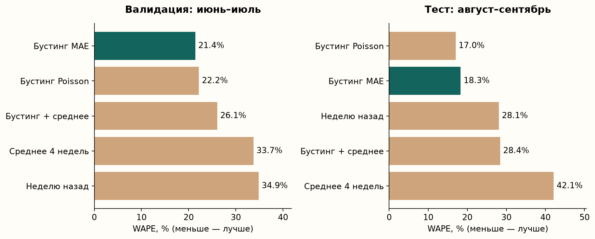
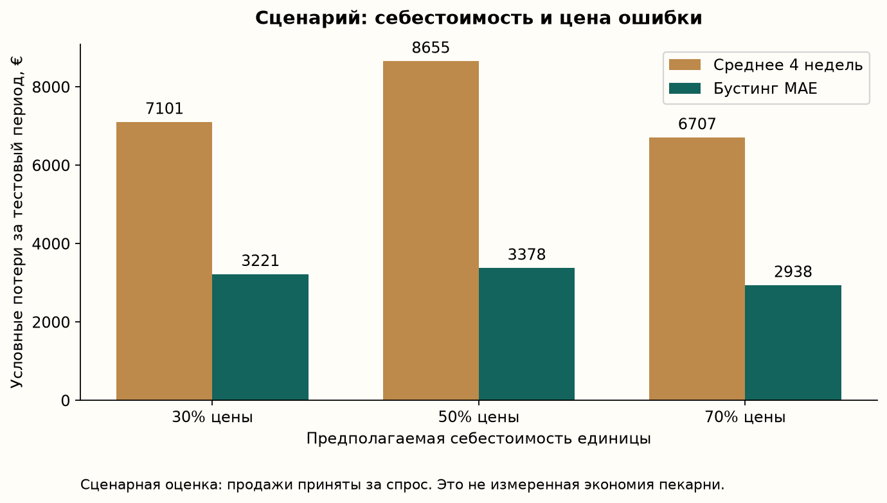

# Прогнозирование ежедневных продаж хлебобулочных изделий для планирования производства в небольшой пекарне

## Аннотация

В работе разработан прототип системы машинного обучения для прогнозирования продаж восьми товаров одной пекарни на следующий день. Исследование включает постановку бизнес-задачи, аудит открытых кассовых данных, построение признаков, сравнение методов на последовательных временных периодах и сценарную оценку экономической пользы. Исходный набор French Bakery Daily Sales содержит 234 005 строк за 2021–2022 годы. Выбранная на валидации модель градиентного бустинга получила на итоговом тесте WAPE 18,28% против 28,07% у прогноза «как неделю назад». Финансовый эффект оценён при допущениях, поскольку в источнике отсутствуют сведения о выпуске, остатках и списаниях.

## 1. Бизнес-задача

Рассматривается небольшая пекарня, продающая хлеб и свежую выпечку. Ежедневно после закрытия управляющий составляет план выпуска на следующий рабочий день. У продукции ограниченный срок реализации. Избыточный выпуск увеличивает стоимость списаний, а недостаточный может привести к потере продаж.

Объектом автоматизации является подготовка прогноза по ассортименту. Пользователь получает ожидаемый объём продаж каждого товара и использует его при планировании. Решение об окончательном объёме выпуска остаётся у управляющего: в курсовой нет достоверных сведений о мощности печи, составе смен и остатках сырья.

Задача актуальна как пример применения прогнозирования к ежедневному решению малого бизнеса. В работе не доказывается отсутствие ML в хлебопечении и не оценивается доля его внедрения. Предлагаемый вклад — воспроизводимая проверка доступного метода на конкретном наборе данных.

Границы проекта: одна пекарня, восемь регулярно продающихся товаров, горизонт один календарный день. Исключены услуги нарезки, составные предложения, прогнозирование новых товаров, автоматические закупки и оптимизация производственного расписания.

## 2. Гипотеза и ожидаемый результат

Исследовательская гипотеза: модель, учитывающая календарные признаки и недавнюю динамику продаж, прогнозирует продажи точнее простых правил «как неделю назад» и «среднее четырёх предыдущих одинаковых дней недели».

Гипотеза проверяется по WAPE на временном отрезке, который не используется для выбора модели. MAE показывает ошибку в физических единицах. RMSE и средняя знаковая ошибка дополнительно характеризуют крупные промахи и систематическое завышение либо занижение.

Бизнес-гипотеза: повышение точности позволит улучшить план выпуска и уменьшить суммарные потери от избытка и нехватки. Эта гипотеза сильнее исследовательской. Её нельзя подтвердить только ошибкой прогноза: нужны цены, себестоимость, сведения о запасах и наблюдение за изменением производства. В курсовой используется сценарная оценка, а для реального подтверждения предлагается пилот.

## 3. Данные и предварительная обработка

Использован набор [French Bakery Daily Sales](https://www.kaggle.com/datasets/matthieugimbert/french-bakery-daily-sales), опубликованный Matthieu Gimbert. По описанию автора это реальные продажи французской пекарни. Исходный файл скачан напрямую с Kaggle, его контрольная сумма сохранена в проекте. Детальное происхождение кассовой выгрузки независимо не подтверждено.

В CSV есть дата и время продажи, номер чека, название, количество и цена. Дополнительный столбец является экспортированным индексом и исключён. Период фактических записей: 02.01.2021–30.09.2022. Набор содержит 149 названий, включая услуги и составные категории. Для эксперимента заранее зафиксированы восемь отдельных товаров: TRADITIONAL BAGUETTE, CROISSANT, PAIN AU CHOCOLAT, BANETTE, BAGUETTE, CEREAL BAGUETTE, BOULE 400G и CAMPAGNE.

В ходе аудита выявлены следующие особенности:

- 37 календарных дат не содержат никаких записей. Они остаются неизвестными, поскольку нельзя отличить закрытие пекарни от пропуска выгрузки.
- 1 295 строк имеют отрицательное количество. Они учитываются при дневной агрегации как корректировки. Удаление только отрицательных строк исказило бы итог.
- 1 210 строк совпадают по содержательным полям. Они сохранены, так как номер чека не является уникальным идентификатором строки продажи.
- 32 строки имеют нулевую цену. Количество учитывается, но при расчёте типичной цены для экономики используются только положительные цены из обучающей истории.
- Если в дату есть другие транзакции, отсутствие выбранного товара трактуется как нулевые продажи. Для выбранного ассортимента это 16 пар «товар–день».

Создаётся ежедневная таблица по каждому товару. Количество суммируется с учётом знака. Отрицательный суммарный итог обрезается на нуле с отдельным учётом такого случая в аудите. У выбранных товаров отрицательных дневных итогов не оказалось. После агрегации известны 4 800 значений «товар–день», а 296 значений соответствуют неизвестным датам. Первые 35 дней истории служат для прогрева признаков.

## 4. Целевая переменная и признаки

Целевая переменная для товара i и дня t:

\[
y_{i,t}=\max\left(0,\sum_{j\in\text{записи}(i,t)}q_j\right).
\]

Это наблюдаемые нетто-продажи, а не полный спрос. Если товар закончился, касса не регистрирует неудовлетворённые намерения покупателей. Прогноз `ŷ` помогает выбрать выпуск `Q`, который уже влияет на остатки и маржу. Снижение `ŷ` само по себе не является бизнес-успехом.

Признаки делятся на календарные и исторические. Календарные: день недели, месяц, признак выходного, годовые синус и косинус, номер дня относительно начала календарной шкалы. Исторические: продажи 1, 7, 14 и 28 дней назад, средние за предыдущие 7 и 28 дней, стандартное отклонение за 28 дней, среднее и медиана за четыре предыдущих аналогичных дня недели, количество наблюдавшихся дней за последние 28 дней. Название товара передаётся как категория в общую модель.

Все исторические агрегаты сдвинуты минимум на один день. Фактическая цена, время чека, объём продаж и наличие записей прогнозируемого дня не входят в признаки. Отдельный тест программы меняет текущие и будущие целевые значения и проверяет, что признаки на рассматриваемую дату остаются прежними.

## 5. Методы и схема оценки

Задача решается как регрессия на табличных признаках временного ряда. Рассмотрены пять заранее заданных кандидатов:

1. Продажи того же товара семь календарных дней назад.
2. Среднее продаж за четыре предыдущих таких же дня недели.
3. Градиентный бустинг с абсолютной ошибкой как функцией потерь.
4. Градиентный бустинг с функцией потерь Poisson для неотрицательной цели.
5. Среднее двух прогнозов с весами 50/50: бустинг MAE и базовый метод четырёх недель.

Использована реализация `HistGradientBoostingRegressor` из scikit-learn. Параметры: 250 итераций, скорость обучения 0,06, до 15 листьев, минимум 20 наблюдений в листе, L2-регуляризация 5. Случайная внутренняя ранняя остановка отключена. Параметры не подбирались на финальном тесте.

Первая валидация: модель обучается на истории до 01.06.2022 и прогнозирует июнь. Вторая: обучается до 01.07.2022 и прогнозирует июль. Основной метод выбирается по WAPE объединённых прогнозов двух месяцев. Затем модель обучается на истории до 01.08.2022 и проверяется на августе–сентябре. Случайное перемешивание дат не используется.

Оценка соответствует работе вечером каждого дня: уже завершившиеся дни теста можно использовать в лагах, а веса модели до конца теста остаются фиксированными. Такой протокол нельзя описывать как прогноз всей двухмесячной последовательности из одной начальной точки.

Метрики:

\[
\operatorname{MAE}=\frac{1}{N}\sum|y-\hat y|,\qquad
\operatorname{WAPE}=\frac{\sum|y-\hat y|}{\sum y}\cdot100\%.
\]

WAPE агрегирует ошибку относительно общего объёма продаж. Нулевые отдельные значения не приводят к делению на ноль, как в построчном MAPE. При этом массовые товары сильнее влияют на итог, поэтому дополнительно показаны метрики каждого товара и месяца. MAE измеряется в штуках на пару «товар–день».

## 6. Результаты эксперимента

| Метод | WAPE на валидации | WAPE на тесте | MAE на тесте |
|---|---:|---:|---:|
| Продажи неделю назад | 34,85% | 28,07% | 18,78 |
| Среднее четырёх недель | 33,73% | 42,08% | 28,15 |
| **Бустинг MAE** | **21,40%** | **18,28%** | **12,23** |
| Бустинг Poisson | 22,17% | 17,00% | 11,37 |
| Смесь 50/50 | 26,05% | 28,40% | 19,00 |

На валидации выбран бустинг MAE. Тест включает 59 дней с записями и 472 наблюдения. Относительное снижение WAPE основной модели составляет 34,88% по сравнению с методом «неделю назад» и 56,56% по сравнению со средним четырёх недель, которое было лучшим базовым методом на валидации.

На тесте Poisson показал меньшую ошибку. Однако менять основную модель после просмотра этого результата означало бы использовать тест для выбора. Поэтому основным итогом остаётся заранее выбранный бустинг MAE. Все результаты сохранены, чтобы сравнение не зависело от выборочного представления цифр.

В сентябре ошибка среднего четырёх недель достигает 75,50%, тогда как в августе составляет 29,70%. Это согласуется с его запаздыванием при изменении уровня продаж. Выбранный бустинг имеет WAPE 17,91% в августе и 19,27% в сентябре. Причины изменения продаж из имеющихся данных установить нельзя.

Для ориентировочной оценки неопределённости выполнен парный bootstrap семидневными календарными блоками, 2 000 повторов. 95%-интервал разности WAPE «бустинг MAE минус выбранный базовый метод» составляет от −53,51 до −9,36 процентного пункта. Результат поддерживает преимущество на данном периоде, но интервал приблизительный и не доказывает переносимость на другие предприятия.

Исследовательская гипотеза поддержана в пределах выбранного датасета и протокола. Для другой пекарни или более позднего периода потребуется отдельная проверка.

## 7. Сценарная оценка экономической пользы

Для иллюстрации связи модели с бизнесом вводится функция потерь относительно плана при идеально известном спросе:

\[
L(Q,D)=c\max(Q-D,0)+(p-c)\max(D-Q,0),
\]

где Q — выпуск, D — спрос, p — цена продажи, c — себестоимость. Первый член — стоимость излишка, второй — недополученная маржа из-за нехватки. В сценарии нет остаточной стоимости, переноса на следующий день и замещения одного товара другим. Ограничения мощности не моделируются.

Из-за отсутствия данных о спросе используем наблюдаемые продажи как его приближение. Цену каждого товара фиксируем как медиану положительных цен в обучающей истории. Себестоимость задаём на уровнях 30%, 50% и 70% цены. Выпуск равен округлённому прогнозу, умноженному на коэффициент из набора 0,8–1,4 с шагом 0,1. Коэффициент для каждого метода и сценария выбирается только на валидации.

При себестоимости 50% цены условные потери на тестовом периоде составляют:

| Метод | Коэффициент выпуска | Потери в сценарии, € |
|---|---:|---:|
| Продажи неделю назад | 1,0 | 5 195,98 |
| Среднее четырёх недель | 1,1 | 8 655,00 |
| Выбранный бустинг MAE | 1,0 | 3 377,65 |

Снижение сценарных потерь относительно метода «неделю назад» составляет около 35%. Это результат условного расчёта, а не измеренная экономия пекарни. Другие уровни себестоимости и все кандидаты приведены в `reports/economic_scenarios.csv`.

## 8. Проектирование системы и применение

Прототип состоит из загрузчика CSV, модуля проверки и агрегации, расчёта исторических признаков, обучения и сравнения моделей, формирования отчётов и команды прогнозирования. Контрольная сумма защищает воспроизводимость от незаметной замены версии источника. Код, параметры и агрегированные результаты готовы к публикации на GitHub.

После завершения независимой оценки выбранная модель отдельно переобучается на всей истории. Команда прогнозирования читает историю и локальный артефакт, рассчитывает признаки для следующего дня и возвращает значения по восьми товарам. Для исходного набора это 01.10.2022. Фактические продажи этого дня в данных отсутствуют, поэтому результат служит демонстрацией применения.

Для реального внедрения нужны свежая выгрузка конкретной пекарни, известное расписание, данные об остатках и выпуске. Предлагается начать с параллельного расчёта прогнозов без изменения производства. После накопления данных можно провести пилот с заранее установленными правилами сравнения. Бизнес-критерии — стоимость списаний, валовая маржа и доступность товаров. Периоды должны быть сопоставимы по сезону и дням недели.

Мониторинг включает еженедельные MAE/WAPE по товарам, систематические смещения, полноту данных, изменения ассортимента и цен. При отсутствии данных используется согласованный базовый прогноз и решение управляющего. Переобучение требуется при накоплении новой истории или существенных изменениях режима работы.

## 9. Выводы и развитие

В работе пройден цикл от постановки задачи до воспроизводимого эксперимента на реальных данных по описанию источника. На выбранном тестовом периоде модель улучшила прогноз относительно обоих простых методов. Связь с бизнес-метриками выражена через стоимость ошибок производственного плана.

Основные ограничения связаны с наблюдением продаж вместо полного спроса, неизвестной причиной пропусков, короткой историей и отсутствием финансовых и складских показателей. Следующие направления: сбор времени исчерпания запасов, прогноз квантилей для разных стоимостей ошибок, учёт производственных ограничений и дополнительная последовательная проверка на свежих данных.

## Источники

1. Matthieu Gimbert. French Bakery Daily Sales. Kaggle. https://www.kaggle.com/datasets/matthieugimbert/french-bakery-daily-sales — исходные данные, описание и условия доступа.
2. Scikit-learn. HistGradientBoostingRegressor. https://scikit-learn.org/stable/modules/generated/sklearn.ensemble.HistGradientBoostingRegressor.html — реализация модели и значения параметров.
3. Hyndman R. J., Athanasopoulos G. Forecasting: Principles and Practice, 3rd ed. Time series cross-validation. https://otexts.com/fpp3/tscv.html — последовательная оценка прогнозов.
4. Собственный воспроизводимый эксперимент: `reports/summary.json`, `reports/data_audit.json`, `reports/*metrics*.csv`. Версии библиотек и контрольная сумма сохранены рядом с результатами.

## Дополнение: расширенное исследование и внедрение

После первоначального эксперимента выполнена ретроспективная проверка на 11 месячных окнах: WAPE HGB MAE 28,08% против 35,18% у lag7, победа в 10 из 11 месяцев. Добавлены macro MASE/RMSSE, исключение групп признаков и интервалы с разными длинами временного блока. Исходная модель и её тестовые метрики сохранены; новую версию необходимо проверить на свежем периоде.

ML уже применяется в пекарнях, что подтверждают отраслевые исследования; доля его использования среди малых российских пекарен здесь не оценивалась. Обоснование, первичные источники и ограничения приведены в [обзоре исследований](research_review.md). Презентация и ноутбук относятся к первоначальному эксперименту; дополнение хранится отдельно.

Для перехода к реальному использованию подготовлены [постановка ML-команде](ml_team/brief.md), [18 задач](ml_team/backlog.md) и [план поставки](ml_team/delivery_plan.md). Они включают сбор наличия и списаний, проверку нового теста, квантили, ограничения выпуска, shadow-режим и контролируемый пилот. Задачи ещё не исполнены и не назначены сотрудникам.
