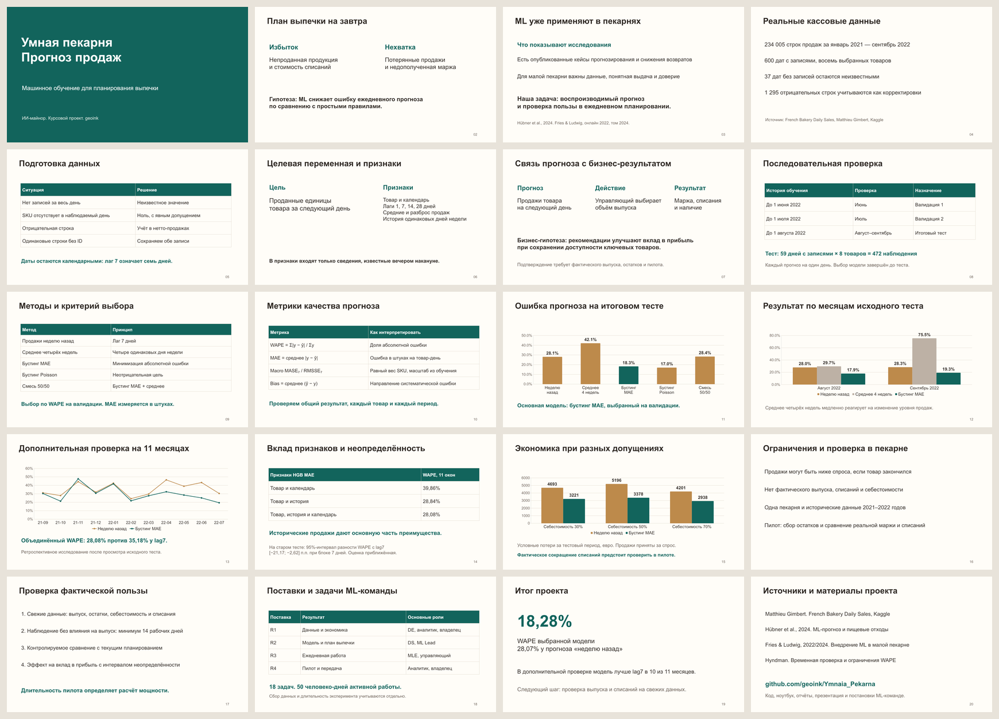

# Презентация «Умная пекарня»

Версия от 10 ноября 2026 года. 20 слайдов, ориентир 12–15 минут. Таблицы и диаграммы в PowerPoint редактируются; заметки докладчика содержат объяснения и источники.

| Материал | Открыть или скачать |
|---|---|
| PowerPoint | [Скачать PPTX](../presentation.pptx?raw=true) |
| Версия без PowerPoint | [Открыть PDF](../presentation.pdf) |
| Заметки докладчика | [Текст выступления](../presentation.md) |
| Проверка требований курсовой | [Таблица соответствия заданию](../requirements_checklist.md) |
| Протокол и ключевые числа | [Паспорт эксперимента](../experiment_passport.md) |

После публикации через `--presentation-release` файлы также доступны как отдельные вложения во вкладке [Releases](https://github.com/geoink/Ymnaia_Pekarna/releases). Эта ссылка ведёт на список выпусков и работает независимо от выбранного тега.

## Структура выступления

| Слайды | Содержание |
|---|---|
| 1–3 | Бизнес-задача, гипотеза и отраслевой контекст |
| 4–7 | Реальные данные, очистка, target, признаки и бизнес-метрики |
| 8–10 | Временная валидация, методы и метрики |
| 11–15 | Исходный тест, 11 дополнительных окон, вклад признаков и сценарная экономика |
| 16–18 | Ограничения, пилот и задачи ML-команды |
| 19–20 | Выводы, источники и материалы проекта |
