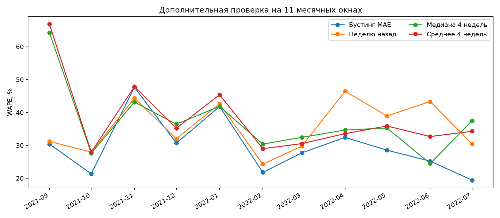

# Усиление исследования: литература, устойчивость и следующие проверки

Материалы проверены 9 ноября 2026 года. Этот документ дополняет исходную курсовую. Новые вычисления выполнены после просмотра исходного теста, поэтому являются ретроспективным исследованием. Они не создают новую независимую оценку и не заменяют выбранную ранее модель `hgb_absolute`.

## Что известно из внешних источников

| Источник | Что он подтверждает | Граница вывода | Следствие для проекта |
|---|---|---|---|
| Hübner et al., 2024, [Machine-learning-based demand forecasting against food waste](https://link.springer.com/article/10.1111/jiec.13528), DOI 10.1111/jiec.13528 | Применение ML и анализ экологических последствий на кейсе пекарни; авторы сообщают о среднем снижении возвратов на 30% в 2022 по отчётам продаж | Это результат другого бизнеса и процесса, не наш эффект и не универсальная причинная оценка | ML в отрасли уже существует; измерять собственные списания и финансовый результат |
| Fries & Ludwig, [‘Why are the Sales Forecasts so low?’](https://link.springer.com/article/10.1007/s10606-022-09458-z), онлайн 2022, том 2024 | Внедрение в небольшой пекарне зависит от инфраструктуры, рабочего процесса, доверия и восприятия качества | Качественный кейс не измеряет долю внедрения ML в отрасли | Предусмотреть журнал правок, понятную выдачу, shadow-режим и обсуждение с управляющим |
| Hyndman & Athanasopoulos, [Forecasting: Principles and Practice, Time series cross-validation](https://otexts.com/fpp3/tscv.html) | Оценка прогнозов с движущейся точкой отсечения и обучением только на прошлом | Окна одной пекарни не доказывают переносимость на другие | Проверять несколько временных отрезков и отдельно новые данные |
| Hyndman, 2025, [WAPE: Weighted Absolute Percentage Error](https://otext.robjhyndman.com/hyndsight/wape.html) | Ограничения WAPE при нестационарности; аргументы за обучение-зависимые масштабы MASE/RMSSE | MASE/RMSSE тоже зависят от качества обучающей истории и знаменателя | Сохранять WAPE для интерпретации, добавлять масштабирующие метрики и разрезы |
| Wang et al., [FreshRetailNet-50K](https://arxiv.org/abs/2505.16319), 2025, обновлённая версия 2026 | 50 тысяч рядов store-product; 898 магазинов, 18 городов, 863 скоропортящихся SKU; почасовая разметка stockout и двухэтапное восстановление спроса | Другой ритейл и другой масштаб; в этой работе этот набор не обучался и не оценивался | Возможный внешний benchmark для исследования продаж, ограниченных наличием |
| scikit-learn, [Prediction intervals for gradient boosting regression](https://scikit-learn.org/stable/auto_examples/ensemble/plot_gradient_boosting_quantile.html) | Практический пример квантильной регрессии и проверки интервалов | Номинальная квантиль не гарантирует покрытие на новых данных | Добавить pinball loss и калибровку перед рекомендациями по выпуску |

Официальные ресурсы FreshRetailNet: [набор](https://huggingface.co/datasets/Dingdong-Inc/FreshRetailNet-50K), [код](https://github.com/Dingdong-Inc/frn-50k-baseline). Для будущей работы отдельно проверить актуальную лицензию, объём вычислений и соответствие задаче.

**Корректная мотивация:** небольшим пекарням может быть полезна доступная система ежедневного прогнозирования и планирования, совместимая с их кассой и рабочим процессом. Данных о распространённости ML среди российских малых пекарен у проекта нет. Формулировка «ML в пекарнях не используется» не подтверждается.

## Что дополнительно проверено на нашем датасете

Использован тот же [French Bakery Daily Sales](https://www.kaggle.com/datasets/matthieugimbert/french-bakery-daily-sales), контрольная сумма сохранена в `reports/research/summary.json`. Ассортимент, правила обработки пропусков и параметры моделей сохранены. Код: `src/bakery_forecast/research.py`.

- **11 расширяющихся месячных окон:** сентябрь 2021 — июль 2022; 2 536 наблюдений «SKU–день». Модель переобучается на старте месяца. Каждый прогноз однодневный, факты предыдущих дней доступны для лагов.
- **Девять вариантов:** исходные пять, медиана четырёх одинаковых дней недели, среднее предыдущих семи дней, HGB только с календарём и HGB только с историческими признаками.
- **Дополнительные метрики:** macro MASE7 и RMSSE7 с масштабом только по прошлому; средняя и худшая месячная ошибка.
- **Неопределённость старого теста:** парный блочный bootstrap по календарным дням; блоки 3, 7 и 14 дней; сравнение и с lag7, и со средним четырёх недель.

| Вариант | WAPE на 11 окнах | Средний macro MASE7 | Средний macro RMSSE7 |
|---|---:|---:|---:|
| HGB Poisson, исследовательский кандидат | 27,22% | 0,819 | 0,784 |
| **HGB MAE, исходная основная модель** | **28,08%** | **0,852** | **0,811** |
| HGB: только история и товар | 28,84% | 0,837 | 0,798 |
| Как неделю назад | 35,18% | 1,027 | 1,009 |
| Скользящее среднее 7 дней | 36,94% | 1,012 | 0,946 |
| Медиана 4 одинаковых дней недели | 37,07% | 1,004 | 0,956 |
| Среднее 4 одинаковых дней недели | 37,71% | 1,019 | 0,958 |
| HGB: только календарь и товар | 39,86% | 1,092 | 0,982 |

Все девять вариантов, включая фиксированную смесь: [полная таблица](../reports/research/aggregate_metrics.csv). WAPE объединяет ошибки и продажи всех наблюдений. Масштабированные метрики сначала усредняются по SKU, затем по месяцам; поэтому ранжирование может различаться. MASE < 1 означает ошибку ниже обучающего сезонного масштаба, а не автоматически победу над lag7 на каждом тестовом месяце.



## Интерпретация результатов

1. **Преимущество сохраняется на более длинном отрезке, но неоднородно.** HGB MAE лучше lag7 в 10 из 11 окон. Объединённый WAPE ниже на 7,10 п.п., или примерно 20,18% относительно lag7. На исходном августе–сентябре относительное улучшение было 34,88%; его нельзя переносить на весь год. Худший месяц HGB MAE имеет WAPE 47,69%.
2. **История продаж важнее одного календаря в этой конфигурации.** Calendar-only даёт 39,86%, history-only — 28,84%, полный вариант — 28,08%. При этом history-only немного лучше по macro MASE/RMSSE. Это не основание заявлять универсальную пользу всех календарных признаков и не причинный анализ.
3. **Средняя ошибка скрывает различия товаров.** На исходном тесте WAPE HGB MAE варьируется от 14,16% у TRADITIONAL BAGUETTE до 28,52% у BOULE 400G. У самого продаваемого товара средний bias составляет −15,21 шт./день. Нужны проверки доступности и индивидуальной цены дефицита, а не только общий WAPE. [Разрез по товарам](../reports/metrics_by_product.csv).
4. **Вывод чувствителен к периоду и способу измерения неопределённости.** На старом тесте 95%-интервал разности WAPE HGB MAE минус lag7 при блоке 7 дней составляет [−21,17; −2,62] п.п.; при блоках 3 и 14 дней знак также отрицателен. Это приближённая диагностика короткого неоднородного периода, не гарантия будущей пользы. Множественные post-hoc сравнения не корректировались. [Чувствительность bootstrap](../reports/research/bootstrap_sensitivity.csv).
5. **Poisson заслуживает дальнейшей проверки.** Он лучше в расширенном исследовании и на уже известном тесте. Выбор новой основной модели по этим результатам потребует нового заранее зафиксированного протокола и свежей закрытой оценки. Исходный результат остаётся результатом HGB MAE.

## От прогноза продаж к плану выпуска

Продажи ограничены наличием. Если товар закончился к полудню, дневная касса не показывает полный спрос. В исходном наборе нет выпуска, остатков, времени stockout и фактических списаний. Поэтому нельзя утверждать, что модель сокращает отходы на вычисленный процент или увеличивает прибыль на сценарную сумму.

Для простейшей модели одного периода без уценки и переноса остатка стоимость ошибки:

`L(Q,D) = c × max(Q−D,0) + (p−c) × max(D−Q,0)`.

Если известны настоящий спрос D, цена p и переменная себестоимость c, оптимальный неограниченный объём соответствует квантили `τ = (p−c)/p = 1−c/p`. Для c/p = 0,3 / 0,5 / 0,7 это τ = 0,7 / 0,5 / 0,3. Это теоретический ориентир: уценка, утилизация, партии, общая печь и замещение товаров меняют задачу. Квантили продаж не становятся квантилями скрытого спроса автоматически.

Очередность следующего исследования: реальные затраты и наличие → протокол свежей оценки → сильные baselines → квантили и цензурирование → ограниченный план → shadow → контролируемый пилот. Эта последовательность разложена на [18 задач ML-команды](ml_team/backlog.md).

## Воспроизведение и границы готовности

```bash
bakery download
bakery research
# Или: bakery research --data '/path/to/Bakery sales.csv'
```

Результаты создаются в `reports/research/`. Исходный ноутбук и презентация фиксируют первоначальный эксперимент; это исследовательское дополнение хранится отдельно. Новые таблицы не подменяют старый test score, а экономические сценарии не подменяют фактический пилот.

**Проверено:** вычисленные ошибки и устойчивость на одном открытом наборе. **Предположено:** полнота кассы, ноль для отсутствующего SKU в наблюдаемый день, сценарная себестоимость. **Предстоит измерить:** скрытый спрос, реальное изменение списаний/вклада в прибыль, переносимость на конкретную пекарню и принятие рекомендаций управляющим.
