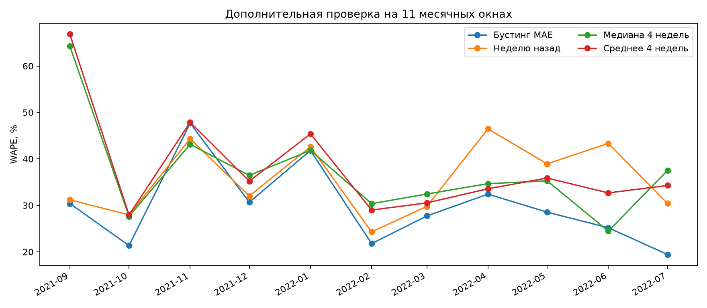

# Дополнительный эксперимент

Это ретроспективное исследование после просмотра исходного теста. Оно расширяет диагностику, но не создаёт новый независимый тест и не меняет основной результат.

11 месячных окон: сентябрь 2021 — июль 2022. На старте каждого месяца модель переобучается только на предыдущей истории. Прогнозы однодневные, предыдущие факты внутри месяца доступны для лагов.

| Метод | Объединённый WAPE | Средний MASE₇ по месяцам и товарам | Средний RMSSE₇ |
|---|---:|---:|---:|
| hgb_poisson | 27.22% | 0.819 | 0.784 |
| hgb_absolute | 28.08% | 0.852 | 0.811 |
| history_only | 28.84% | 0.837 | 0.798 |
| blend_absolute | 31.38% | 0.892 | 0.849 |
| lag_7 | 35.18% | 1.027 | 1.009 |
| rolling_mean_7 | 36.94% | 1.012 | 0.946 |
| weekday_median_4 | 37.07% | 1.004 | 0.956 |
| weekday_mean_4 | 37.71% | 1.019 | 0.958 |
| calendar_only | 39.86% | 1.092 | 0.982 |

Знаменатели MASE/RMSSE считаются только по обучающим данным отдельно для каждого товара, сезонный шаг 7 календарных дней. Пары с пропусками не используются. Сначала усредняем по товарам, затем по месяцам. WAPE объединён по всем наблюдениям. Это разные способы взвешивания, и их ранжирование может различаться.

## Стабильность относительно простых правил

- Бустинг MAE лучше `lag_7` в 10 из 11 окон.
- Бустинг MAE лучше `weekday_mean_4` в 11 из 11 окон.
- Бустинг MAE лучше `weekday_median_4` в 9 из 11 окон.
- Бустинг MAE лучше `rolling_mean_7` в 8 из 11 окон.

## Исключение групп признаков

`calendar_only` использует только товар и календарь. `history_only` использует товар, лаги и исторические статистики без явных календарных полей. Параметры бустинга одинаковы. Разность ошибок показывает вклад группы в данной конфигурации, но не доказывает причинное влияние отдельного признака.

## Неопределённость исходного результата

На уже известном тесте повторён блочный bootstrap разности WAPE (MAE-бустинг минус baseline) с блоками 3, 7 и 14 календарных дней. Отрицательный интервал благоприятен для бустинга. Это приближённые интервалы короткого неоднородного периода.

| Baseline | Длина блока | 95%-интервал разности WAPE, п.п. |
|---|---:|---:|
| lag_7 | 3 | [-17.22; -3.96] |
| lag_7 | 7 | [-21.17; -2.62] |
| lag_7 | 14 | [-25.31; -2.74] |
| weekday_mean_4 | 3 | [-41.18; -13.20] |
| weekday_mean_4 | 7 | [-53.51; -9.36] |
| weekday_mean_4 | 14 | [-70.71; -8.42] |

Исследование не учитывает скрытый спрос, мощность производства и реальную стоимость списаний. Новые варианты нельзя объявлять подтверждённо лучшими на августе–сентябре после просмотра этого периода. Для следующей версии нужен заранее зафиксированный протокол и свежие данные.
