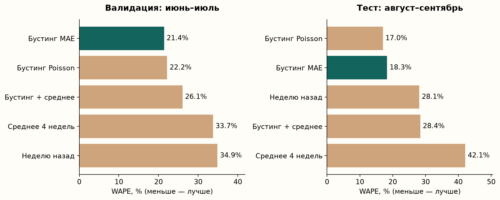
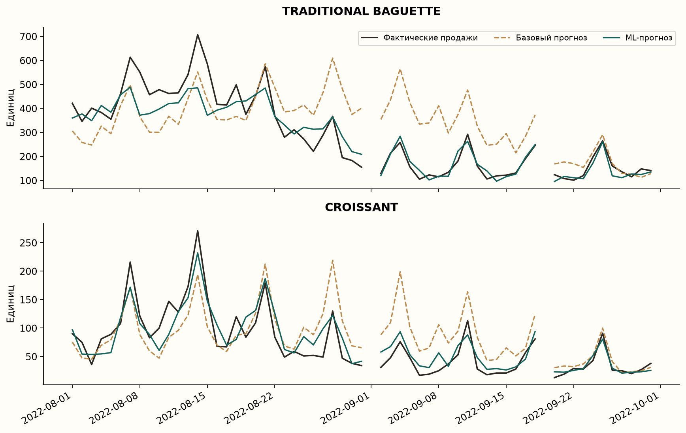
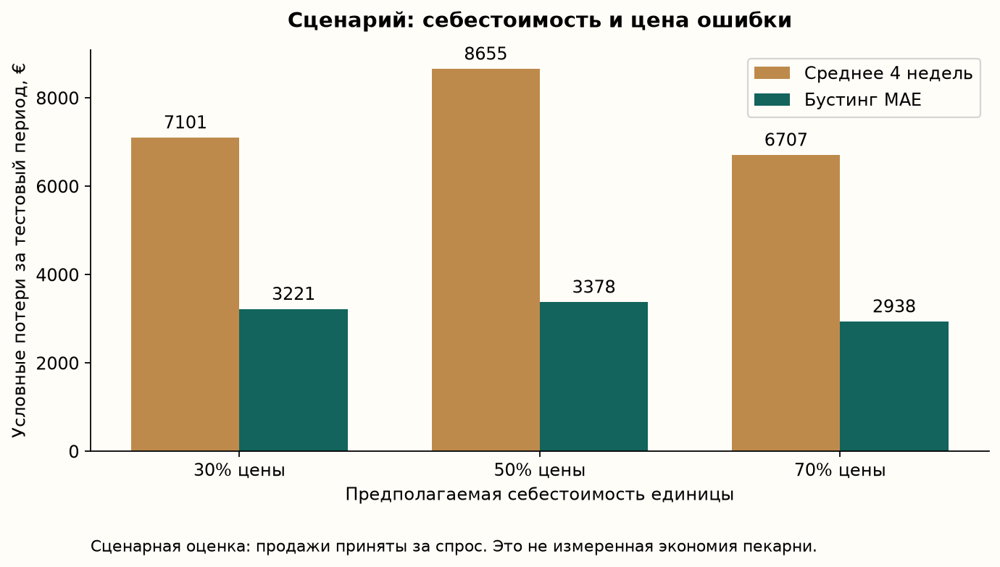

# Результаты воспроизводимого эксперимента

Источник: French Bakery Daily Sales. SHA-256: `af5eede55b6eb2efb6bebb0e6dd1a51568c7eb73554d2f8ad2563081025681b2`.

Исходных строк: **234,005**. Дней с записями: **600**. Период: 2021-01-02 — 2022-09-30. В эксперименте восемь товаров.

## Схема проверки

Две расширяющиеся выборки: обучение до 01.06.2022, проверка на июне; обучение до 01.07.2022, проверка на июле. Основную модель выбираем по суммарному WAPE двух проверок. Затем переобучаем на данных до 01.08.2022 и оцениваем август–сентябрь.

Модель, выбранная до теста: **hgb_absolute**. Тест: **59** дней с записями, **472** пар «день–товар».

Прогноз формируется каждый вечер на следующий день. Фактические продажи прошедших дней теста доступны для лагов, веса модели в течение теста не меняются. Это серия однодневных прогнозов, а не прогноз сразу на два месяца.

## Качество

| Модель | WAPE, валидация | WAPE, тест | MAE, тест, шт. |
|---|---:|---:|---:|
| Неделю назад (`lag_7`) | 34.85% | 28.07% | 18.78 |
| Среднее 4 недель (`weekday_mean_4`) | 33.73% | 42.08% | 28.15 |
| Бустинг MAE (`hgb_absolute`) | 21.40% | 18.28% | 12.23 |
| Бустинг Poisson (`hgb_poisson`) | 22.17% | 17.00% | 11.37 |
| Бустинг + среднее (`blend_absolute`) | 26.05% | 28.40% | 19.00 |

Лучшая ML-модель по валидации: `hgb_absolute`. Снижение WAPE относительно выбранного на валидации базового метода `weekday_mean_4` на тесте: **56.56%**. Относительно «неделю назад»: **34.88%**.

Все кандидаты показаны для прозрачности. Выбирать другую основную модель по результатам этого же теста нельзя: для нового выбора понадобится новый период проверки.

Приблизительный 95%-интервал разности WAPE (ML минус выбранный baseline): **[-53.51; -9.36] п.п.** Парный блочный bootstrap: 2 000 повторов, блок семь календарных дней. Интервал относится к данному короткому периоду и не доказывает переносимость на другие пекарни.

## Сценарная экономика

Это расчёт при допущениях, а не наблюдавшийся финансовый результат. Продажи принимаем за спрос, себестоимость составляет 30/50/70% цены, непроданный товар полностью списывается. Цена каждого товара — медиана его положительных цен в обучающей истории. Коэффициент запаса выбирается только на валидации, отдельно для каждого метода и сценария.

| Себестоимость | Метод | Коэффициент выпуска | Условные потери на тесте, € |
|---|---|---:|---:|
| 30% цены | Неделю назад | 1.2 | 4692.83 |
| 30% цены | Среднее 4 недель | 1.3 | 7101.42 |
| 30% цены | Бустинг MAE | 1.2 | 3220.70 |
| 50% цены | Неделю назад | 1.0 | 5195.98 |
| 50% цены | Среднее 4 недель | 1.1 | 8655.00 |
| 50% цены | Бустинг MAE | 1.0 | 3377.65 |
| 70% цены | Неделю назад | 0.8 | 4201.15 |
| 70% цены | Среднее 4 недель | 0.8 | 6706.72 |
| 70% цены | Бустинг MAE | 0.9 | 2937.54 |

## Ограничения

- Продажи ограничены наличием товара. Время исчерпания запасов, фактический выпуск и списания неизвестны.
- Дни без транзакций исключены из оценки и остаются пропусками в истории. Причина отсутствия записей неизвестна.
- Отсутствие товара в чеках в день с другими продажами считаем нулём. Это допущение требует проверки в реальной пекарне.
- Отрицательные количества учитываем как корректировки. Повторяющиеся строки сохраняем: идентификатор строки продажи отсутствует.
- Одна пекарня, восемь товаров, исторический период 2021–2022. Результат нельзя автоматически переносить на 2026 год.
- Агрегированный WAPE сильнее зависит от массовых товаров. См. отдельные товары и месяцы в CSV-отчётах.

## Следующий шаг

Пилот с владельцем: фиксировать выпуск, остатки, списания и время отсутствия товара. Сначала сравнить прогнозы без изменения работы, затем проверить план выпуска при ограничениях печи, персонала и ассортименте. Финансовый эффект измерять по фактическим данным.

Среда запуска: Python 3.14.4; numpy 2.5.4, pandas 3.1.1, scikit-learn 1.9.1, matplotlib 3.11.2, joblib 1.6.0.
